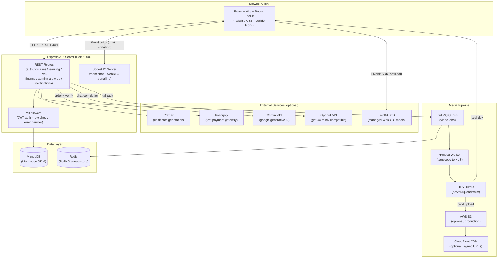
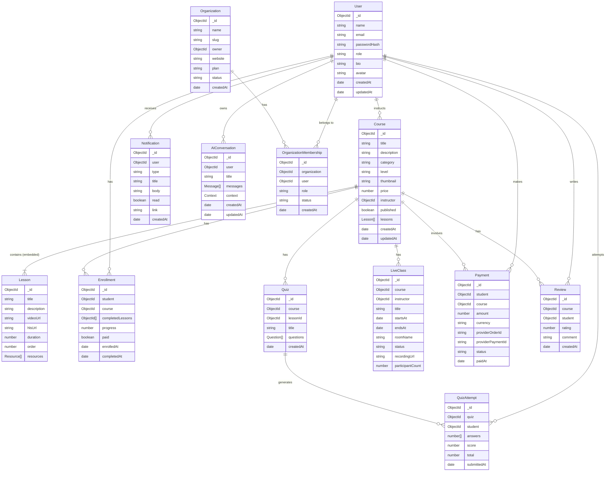
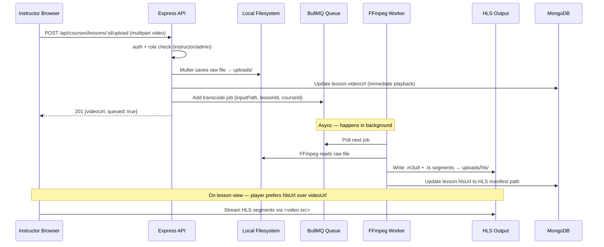
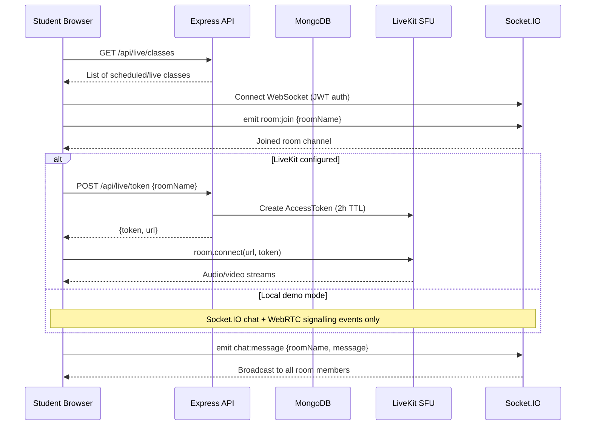
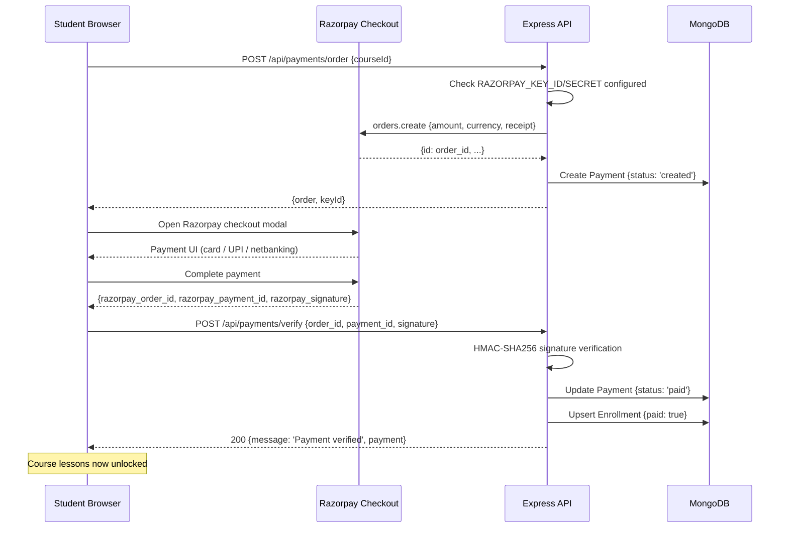
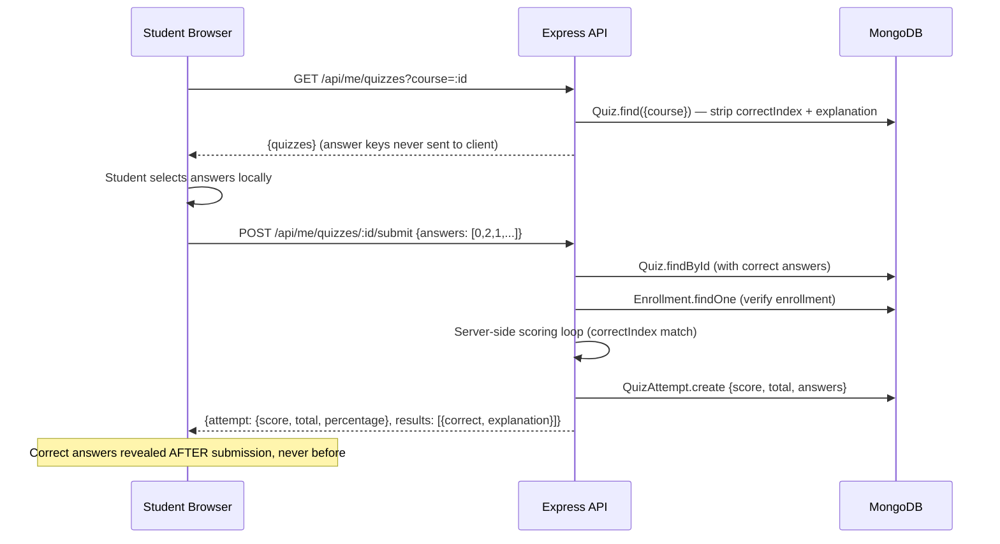
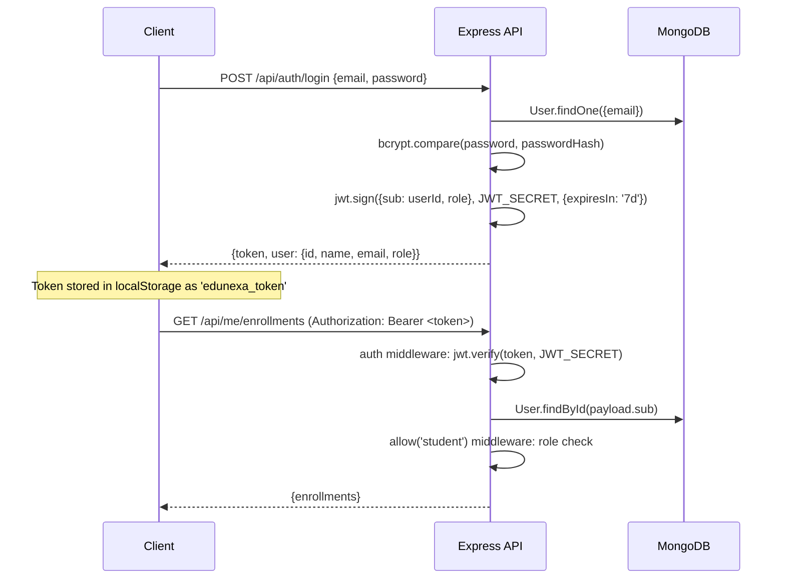

# EduNexa — System Architecture

> **Version:** 2.0 · **Last updated:** November 2026  
> Modular monolith (Node.js + MongoDB) with optional cloud integrations.

---

## 1. System Architecture Overview



---

## 2. Data Model (ER Diagram)



---

## 3. Request Flow Diagrams

### 3.1 Video Upload → Transcode → HLS Delivery



### 3.2 Live Class Join Flow



### 3.3 Payment + Enrollment Flow



### 3.4 Quiz Submission + Grading Flow



---

## 4. Security Architecture

### 4.1 JWT Authentication Flow



### 4.2 Role-Based Access Control

| Role | Registration | Course Management | Enroll / Learn | Quiz Submit | Earnings | Admin Panel | AI Coach | Organizations |
|---|---|---|---|---|---|---|---|---|
| **Student** | Self-register | Read published | ✅ | ✅ | ❌ | ❌ | ✅ | Member |
| **Instructor** | Self-register | Own courses only | ❌ | ❌ | Own earnings | ❌ | ✅ | Member / Owner |
| **Admin** | Admin-provisioned | All courses | ❌ | ❌ | All earnings | ✅ | ✅ | Member / Owner |
| **Org Owner** | Any role + owns org | Per role | Per role | Per role | Per role | ❌ | ✅ | ✅ |
| **Org Admin** | Any role + org admin | Per role | Per role | Per role | Per role | ❌ | ✅ | ✅ |

### 4.3 Never-Expose List

> [!CAUTION]
> The following must **never** be sent to the browser, committed to Git, or logged in plaintext.

| Secret | Why it matters |
|---|---|
| `JWT_SECRET` | Forging tokens grants full account impersonation |
| `RAZORPAY_KEY_SECRET` | Used for HMAC payment verification |
| `GEMINI_API_KEY` / `OPENAI_API_KEY` | Billable; rate-limited per account |
| `AWS_SECRET_ACCESS_KEY` | Full S3 bucket access |
| `LIVEKIT_API_SECRET` | Token minting for media rooms |
| MongoDB/Redis connection strings | Direct database access |
| `passwordHash` fields | Never returned in any user API response |
| `Quiz.questions[].correctIndex` | Never sent until after submission |
| `Quiz.questions[].explanation` | Withheld until after submission |

---

## 5. Frontend Component Architecture

### 5.1 Page Components

| Route | Component | Auth Required | Role |
|---|---|---|---|
| `/login`, `/register` | `AuthPage` | No | Public |
| `/` | `Dashboard` | Yes | All |
| `/learning` | `Learning` | Yes | Student |
| `/courses` | `Courses` | Yes | All |
| `/course/:id` | `CourseDetail` | Yes | All (enroll requires Student) |
| `/live` | `Live` | Yes | All |
| `/quizzes` | `Quizzes` | Yes | Student |
| `/certificates` | `Certificates` | Yes | Student |
| `/ai` | `AIStudio` | Yes | All |
| `/organizations` | `Organizations` | Yes | All |
| `/manage` | `Manage` | Yes | Instructor / Admin |
| `/earnings` | `Earnings` | Yes | Instructor / Admin |
| `/admin` | `Admin` | Yes | Admin only |

### 5.2 Shared Components

| Component | Purpose |
|---|---|
| `Shell` | Root layout: sidebar nav + sticky header + routing outlet |
| `CourseCard` | Reusable course tile (thumbnail, price, level) |
| `CourseProgress` | Enrollment card with progress bar |
| `LiveRoom` | Socket.IO chat + LiveKit media frame |
| `LiveKitMedia` | LiveKit SDK room connection + video grid |
| `QuizList` | Fetches and lists quizzes for enrolled courses |
| `Heading` | Page heading with eyebrow text + optional action button |
| `Empty` | Consistent empty-state placeholder with icon |
| `Notice` | Inline error/success message banner |

### 5.3 State Management (Redux Toolkit)

```
store.js
  └─ authSlice
       ├─ state: { user: null | UserObject, token: string | null }
       ├─ setSession(data) — called after login/register; persists token to localStorage
       └─ logout() — clears state and localStorage token
```

**API Layer:** `client/src/api.js` — Axios instance with base URL `/api` and request interceptor that injects `Authorization: Bearer <token>` from `localStorage.edunexa_token`.

---

## 6. Deployment Architecture

### Development (default)

```
localhost:5173  →  Vite dev server (React)
localhost:5000  →  Express API
localhost:27017 →  MongoDB (Docker)
localhost:6379  →  Redis (Docker)
uploads/        →  Local file storage (Multer)
uploads/hls/    →  FFmpeg HLS output
```

### Production Target

```
CloudFront CDN  →  S3 bucket (private, signed URLs)
                →  React SPA (public bucket or CDN origin)
HTTPS domain    →  Load balancer → Express API (multiple instances)
                →  MongoDB Atlas (managed, replica set)
                →  Redis Cloud / ElastiCache
LiveKit Cloud   →  Managed SFU (WebRTC media)
Secrets Manager →  All credentials (no .env files in prod)
```

> [!IMPORTANT]
> EduNexa is currently a **modular monolith**. MongoDB is the single source of truth. Redis is required only for BullMQ video queuing — all other features work without it. Organization multi-tenancy isolation is a foundation only; full per-organization scoping of courses and payments must be completed before institutional production use.
